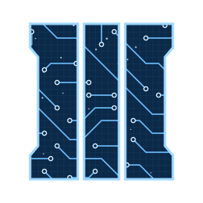

<div align="center">
    
    <h1>T7 Companion</h1>
    <h3><em>The knowledge, the skills and the hands of a seasoned Black Ops 3 modder — for your AI agent.</em></h3>
</div>

<p align="center">
    <a href="https://github.com/McReaper/t7_companion/releases/latest"></a>
    <a href="https://github.com/McReaper/t7_companion/releases"></a>
    <a href="LICENSE"></a>
    
    
</p>

<p align="center">
    <a href="#-what-your-agent-gets">Features</a> ·
    <a href="#-demo">Demo</a> ·
    <a href="#-install">Install</a> ·
    <a href="#%EF%B8%8F-cli">CLI</a> ·
    <a href="#-updating">Updating</a> ·
    <a href="#-contributing">Contributing</a> ·
    <a href="#-license">License</a>
</p>

T7 Companion gives your AI agent everything ten years of the BO3 modding community have learned, every craft down to its silent traps, and its own hands on a full dedicated toolchain: tell it what you want for your mod, and it does the work and checks it. Everything runs offline, on your machine.

## ✨ What your agent gets

- **A knowledge base it searches before answering** — wikis, forums, Discord, Treyarch's scripts, tutorials and the mod-tools schemas. Every hit carries its source, URL and reliability, so the agent can cite it and weigh a Treyarch script above a Discord guess.
- **Skills for each craft** — scripting, mapping, compiling, assets, animation, zombies AI, HUD, FX, atmosphere…: the method and its silent traps.
- **GDT tools** — find, read, check and edit APE's GDTs against the install's own schema, as a dry run unless told to write. `gdt_check` catches broken references, missing files and duplicates before the linker does.
- **What the build packed** — why an asset is in your fastfile, what each zone line weighs, and which of your stock overrides won't ship.
- **A headless build** — create, compile, light, link and launch your map, with a short report of every linker error and warning instead of hundreds of lines: *"Relink zm_mymap"*. Windows only.
- **Shader decompilation** — the game's compiled shaders back to HLSL, to start a custom shader from a stock one.

> [!NOTE]
> <details>
> <summary><b>🔍 Click to see how the pieces fit, in detail</b>: every modding skill, every t7kb tool, every Treyarch tool it runs</summary>
>
> ```mermaid
> ---
> config:
>   layout: elk
>   flowchart:
>     wrappingWidth: 400
> ---
> flowchart TB
>     U(["You"]) <-->|"chat"| A["Your AI agent"]
>     subgraph TC["T7 Companion"]
>         subgraph SK["Modding skills"]
>             scripting["GSC scripting"]
>             mapping["Radiant mapping"]
>             zombies_ai["Zombies AI"]
>             debugging["Debugging"]
>             compiling["Compiling & linking"]
>             assets["Asset porting"]
>             animation["Animation"]
>             anim_retarget["Anim retargeting"]
>             fx_editing["FX editing"]
>             shaders["Custom shaders"]
>             atmosphere["Atmosphere & sound"]
>             hud_lui["HUD & Lua"]
>             localization["Localization"]
>             moving_platforms["Moving platforms"]
>             crossref["Porting from other CoDs"]
>             scripting ~~~ mapping ~~~ zombies_ai ~~~ debugging ~~~ compiling
>             assets ~~~ animation ~~~ anim_retarget ~~~ fx_editing ~~~ shaders
>             atmosphere ~~~ hud_lui ~~~ localization ~~~ moving_platforms ~~~ crossref
>         end
>         subgraph SRV["t7kb MCP server"]
>             t1["search<br/>get"]
>             t2["gdt_find<br/>gdt_get<br/>gdt_schema<br/>gdt_edit<br/>gdt_check<br/>gdt_refs"]
>             t3["create"]
>             t4["build"]
>             t5["zone_explain<br/>zone_contents<br/>zone_check"]
>             t6["shader_decompile"]
>             t7["radiant_open"]
>         end
>         K[("10 years of BO3<br/>modding knowledge")]
>     end
>     subgraph BO3["Your BO3 install"]
>         subgraph SRC["Your sources"]
>             g["GDTs"]
>             sc["GSC / CSC scripts"]
>             z["Zone files"]
>             m[".map sources"]
>         end
>         subgraph MTB["Treyarch's mod tools"]
>             gdtdb["gdtdb"]
>             cod2map64["cod2map"]
>             radiant_modtools["Radiant"]
>             linker_modtools["Linker"]
>             BlackOps3["Black Ops III"]
>             gdtdb ~~~ cod2map64 ~~~ radiant_modtools ~~~ linker_modtools ~~~ BlackOps3
>         end
>         subgraph OUT["What they write"]
>             o1[".d3dbsp map"]
>             o2[".led lighting"]
>             o3[".ff / .xpak fastfiles"]
>             o4["Link reports"]
>             o5["Shader cache"]
>         end
>     end
>     A -->|"loads"| SK
>     A <-->|"calls"| SRV
>     A -->|"edits"| sc
>     t1 -.->|"retrieves"| K
>     t2 -->|"natively supports"| g
>     t3 -->|"creates a map or mod"| SRC
>     t4 ==>|"runs"| MTB
>     MTB -->|"write"| OUT
>     t5 -.->|"reads"| OUT
>     t6 -.->|"decompiles"| o5
>     t7 <-->|"drives, through its bridge plugin"| radiant_modtools
> ```
>
> Solid arrows change something, dotted ones only read, and the thick one runs Treyarch's tools.
>
> </details>

## 🎥 Demo

> [!TIP]
> 🔊 Turn on audio for the end of the demo.

https://github.com/user-attachments/assets/0d533897-fd35-4f0d-9774-948546c0af6b

## 📥 Install

### Claude Code

```
/plugin marketplace add McReaper/t7_companion
/plugin install t7kb@t7-reapy
/reload-plugins
/t7kb:setup-or-update
```

Pick the **User** scope: a project-scope install doesn't load in `usermaps/<map>`.

`/t7kb:setup-or-update` downloads `t7kb` and its database, registers the MCP server, records your BO3 mod-tools root, and offers git tracking for it and plugin auto-update.

### Other MCP clients (Codex, OpenCode, Cursor, Copilot…)

> [!WARNING]
> **The skills are Claude Code only, for now.** Other clients get the knowledge base and every tool, but not the skills. They are plain [`SKILL.md` files](plugin/skills): if your harness can load skills, a pull request that wires them in is welcome.

```bash
curl -fsSL https://raw.githubusercontent.com/McReaper/t7_companion/main/install/install.sh | bash
```
```powershell
irm https://raw.githubusercontent.com/McReaper/t7_companion/main/install/install.ps1 | iex
```

Then register `t7kb mcp` as a stdio server ([per-client config](docs/clients.md)), or paste this README to your agent and let it do that.

The database: a ~0.9 GB download, unpacked to ~3.8 GB on first run.

## ⌨️ CLI

Every tool is also a command: `t7kb` alone opens an interactive search, and [the command list](docs/cli.md) has the rest.

## 🔄 Updating

**Turn on auto-update** for the `t7-reapy` marketplace (`/plugin` → Marketplaces; `/t7kb:setup-or-update` offers it): Claude Code then keeps the skills current, and at the next session start t7kb says when the binary is behind. `t7kb update-check` says whether either is behind, with the commands to update each. To refresh the binary, run `/t7kb:setup-or-update` in Claude Code, or re-run the installer with `--force` / `-Force`.

## 🤝 Contributing

Found a trap a skill doesn't mention, or one that's wrong? Tell your agent in Claude Code: the `contribute` skill writes the fix and, with your go-ahead, opens a pull request. By hand, start from [the authoring guide](plugin/skills/contribute/SKILL.md).

## 📄 License

> [!IMPORTANT]
> Code is **MIT** — see [`LICENSE`](LICENSE). `t7kb.db` bundles knowledge from the BO3 modding community; every entry carries its `source` and `url` for attribution — see [`docs/NOTICE.md`](docs/NOTICE.md).
