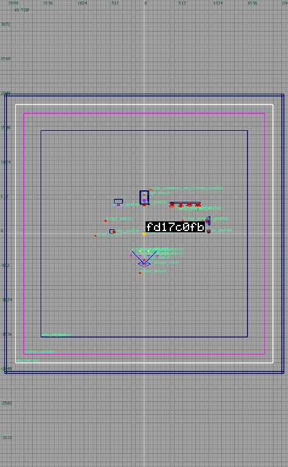
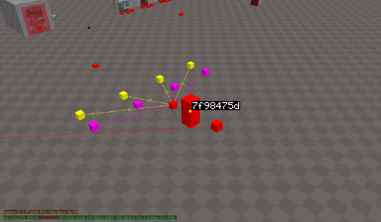
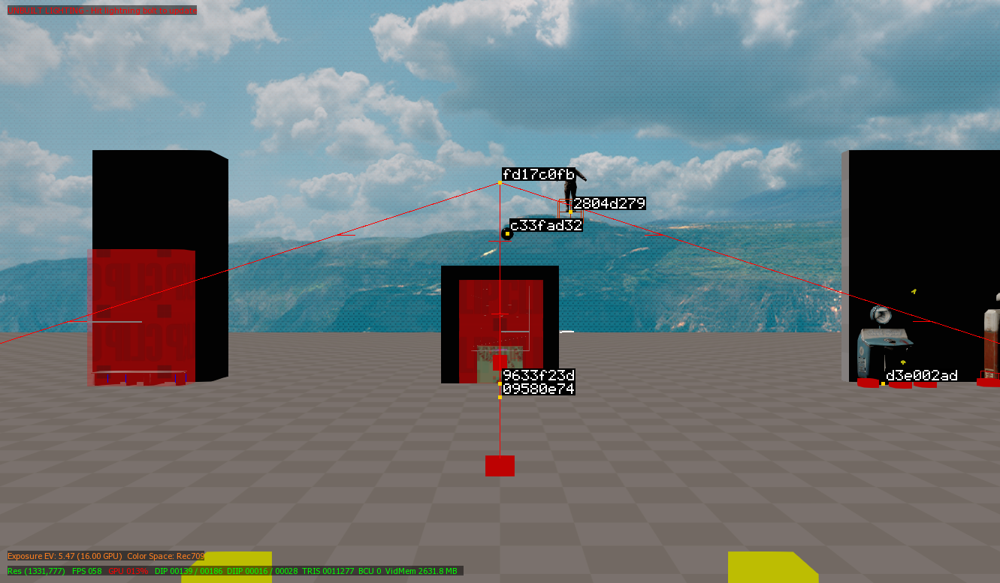

# Map tools: tokens per call

What each of t7kb's map tools costs an agent, from `TestTokenReport` (how to run it: [benchmarks.md](benchmarks.md)).

Measured on the stock ZM Mod Level template's map (33 entities, 20 world brushes), what a map made by `create` holds, served by `radianttest`'s fake Radiant with the views of a real one: a 1648×869 3D view, a 693×1165 2D view (`mapSamples` in `internal/cli/tokens_report_map_test.go`). An image counts as Claude prices it, about width × height / 750 tokens; the JSON beside it, and the ops an agent writes, as text.

| Tool | Call | Tokens | Bytes |
|---|---|---:|---:|
| `radiant_open` | the map already open | 53 | 183 |
| `map_find` | every entity (33) | 1859 | 5895 |
| `map_find` | class `script_struct` (15) | 884 | 3097 |
| `map_find` | near the player start, 256 units, with the world brushes near it | 1081 | 3233 |
| `map_find` | worldspawn's 20 brushes | 831 | 2073 |
| `map_find` | one entity, all keys | 94 | 282 |
| `map_view` | top, framed on the start zone: JSON + 457×768 image | 48 + 467 | 117 + 3558 |
| `map_view` | 3D, framed, `render fake`: JSON + 768×405 image | 52 + 414 | 129 + 2717 |
| `map_view` | 3D as it is, `size 1568`: JSON + 1568×827 image | 84 + 1728 | 190 + 8832 |
| `map_edit` | the ops an agent writes for a room (floor, 4 walls, ceiling as brushes of 8 corners, a light) | 602 | 1333 |
| `map_edit` | the answer to them, with each material's tile | 430 | 1068 |
| `map_edit` | the ops for a floor, two walls caulked top and bottom, a pillar copied three times | 472 | 994 |
| `map_edit` | the answer to them (7 made, 5 materials' tiles) | 329 | 821 |
| `map_edit` | a ramp (6 corners) and a hexagonal column (12) | 236 | 481 |
| `map_edit` | the answer to them (two brushes) | 132 | 350 |
| `map_edit` | a curve patch of 3 by 3 | 126 | 240 |
| `map_edit` | the answer to it (one patch) | 56 | 135 |
| `map_edit` | moving a point entity | 57 | 157 |
| `map_command` | listing `Selection/CSG` | 32 | 111 |
| `map_command` | `CSG Hollow` on a box | 206 | 579 |

A room costs about fifteen hundred tokens: its ops (602, a brush being its corners, eight for a box), the answer (430), a top view to check it (515); a ramp and a hexagonal column are 236, their answer 132; a curve patch of 3 by 3 is 126, its answer 56. The whole map's `map_find` is the dearest call, about 56 tokens an entity, so `class`, `near` or `ids` narrow it; the default image, 768 pixels on the long side, stays near 450 tokens, and `size 1568` quadruples it.

## What the views look like

Each image is what `map_view` hands the agent, taken in a real Radiant on the stock ZM Mod Level template, ids written where each entity's origin or centre is.

| Call | Image |
| --- | --- |
| `view top`, framed on the start zone (475×768) |  |
| 3D, framed on the player start, `render fake`, `hide volumes` (768×448) |  |
| 3D as it is, `size 1568` (1331×777: Radiant's 3D view is smaller than the size asked) |  |
